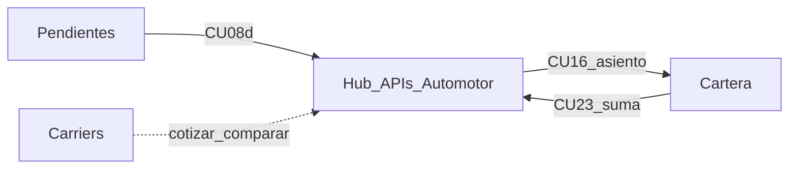

# Iteración 1 SDD — Pendientes, multicotizador (ramos con API) y cartera

Especificación de la primera iteración Spec-Driven Development (SDD) del ERP HOM: el PAS opera pendientes, cotiza ramos con API contra el hub de compañías y asienta la póliza en cartera. Este documento gobierna el orden de trabajo (gate de docs → specify → plan → tasks → implementación). No es arquitectura adoptada.

## Quick path

1. Cerrar el **gate de documentación (DoR)** de esta iteración.
2. Escribir specs del **walking skeleton** (lead → cotizar ramo con API → propuesta → CU-16 desde Pendientes → cartera).
3. Congelar cada artefacto (`status: approved`) antes de la fase siguiente.
4. Implementar solo con stack de [`AGENTS.md`](AGENTS.md): PostgreSQL, Go, presentación Next.js/Templ. El prototipo `front/` es referencia UX, no implementación final.

## 1. Identidad de la iteración

| Campo | Valor |
| --- | --- |
| Nombre | Iteración 1 — Operación PAS (ramos con API) |
| Actor | PAS / productor (usuario final de su cartera) |
| Objetivo de negocio | Cotizar y colocar Automotor, Hogar, Consorcio o Comercio vía hub (solo compañías con API) y ver la póliza en el SoR operativo de la red |
| Criterio de éxito | Flujo E2E: pendiente/lead → cliente → riesgo → comparación → propuesta enviada (`activa=false`) → Dar de alta / CU-16 (`activa=true`) → póliza visible en cartera |
| Fuera de alcance | Cobranza CU-31 y 30–33, comisiones CU-19/20, CU-21, CU-12 persistido, AP/ART, siniestros, admin/organizador, back-office, rúbrica SSN, cross-selling |

## 2. Contexto de dominio

| Tema | Decisión |
| --- | --- |
| Negocio | Intermediación regulada. No somos aseguradora: no underwriteamos ni pagamos siniestros. La póliza legal vive en la compañía. |
| Sistema | SoR operativo de la red: cliente, cotización, emisión asentada, estados que opera el PAS. |
| Hub | Capa anti-corrupción hacia APIs/dialectos de carriers. Particularidades por compañía van en specs/adapters, no en los casos de uso. |
| Carriers con API (índice CU) | Mercantil Andina, Sancor Seguros, Zurich, La Segunda, Allianz — y las que tengan API para Hogar/Consorcio/Comercio. Sin API no hay flujo masivo |
| Unicidad | Un asegurado ↔ un PAS. DNI de otro productor: aviso sin datos, no se cotiza |
| Orden de cotización | Ramo → cliente (CU-10) → riesgo (CU-17 / CU-17b) → comparar (CU-18) |
| Asegurado / tomador | Destinatario de cotizaciones y avisos; no opera el ERP |
| SSN | Restricción legal; no es actor de UI en esta iteración |
| Arquitectura | No hay registro adoptado. No usar «Arquitectura (v1)» de `PRESENTACION-briefing-tecnico.md` ni borradores como decisión vigente |

Fuente de dominio embebida (no sustituye archivos faltantes `MODELO DE NEGOCIO.md` / `middleware.md`): [`PRESENTACION-briefing-tecnico.md`](PRESENTACION-briefing-tecnico.md). Detalle de costos/links de API de middleware: **ausente en el repo**; esta iteración documenta puertos del hub en specs, no inventa el middleware completo.



## 3. Insumos canónicos

Documentación vigente bajo `front/docs/` (incompleta a nivel producto; suficiente como fuente de verdad funcional de esta iteración).

| Insumo | Ruta |
| --- | --- |
| Índice de CU | [`front/docs/casos-de-uso/lista-casos-de-uso-HOM-ERP.md`](front/docs/casos-de-uso/lista-casos-de-uso-HOM-ERP.md) |
| Pendientes | `front/docs/casos-de-uso/PAS/pendientes/` (+ `TRANSICIONES.md`) |
| Multicotizador | `front/docs/casos-de-uso/PAS/multicotizador/` (+ `masivo/`) |
| Cartera | `front/docs/casos-de-uso/PAS/cartera-cliente/` |
| Decisiones abiertas multicotizador | [`front/docs/cuestiones-a-resolver.md`](front/docs/cuestiones-a-resolver.md) |
| Vista secuencia (referencia UX) | `front/docs/vistas/secuencia-efectuar-cotizacion-nuevo-asegurado.md` |
| Estado del repo / stack | [`AGENTS.md`](AGENTS.md) |
| Prototipo | `front/` — validación UX; no stack final. Desvíos vs CU: [`specs/as-built-prototipo-iteracion-1.md`](specs/as-built-prototipo-iteracion-1.md) (orden, ramos, CU-16, CTA cartera). No reabrir decisiones |

### Inventario in-scope

**Pendientes:** CU-05, CU-05b–f (incluye CU-05c), CU-08b–e.

**Multicotizador:** CU-09–16 (común), CU-17, CU-17b, CU-18 (masivo).  
Diferidos: CU-19, CU-20, estimado CU-18, persistir CU-12. Fuera: CU-21.

**Cartera:** CU-22–29.

### Seams entre slices

| Desde | Hacia | Contrato |
| --- | --- | --- |
| CU-08d | Multicotizador | Abrir cotizar con datos del lead |
| CU-16 | Cartera | Mismo paso que «Dar de alta» en Pendientes: póliza + `activa=true` |
| CU-23 | Multicotizador | «+» suma póliza / redirige a cotizar |

## 4. Gate de documentación (DoR)

Obligatorio **antes** de Phase Specify. Sin gate en verde no se abren specs ni código de implementación.

### A. Decisiones bloqueantes

| ID | Tema | Por qué bloquea | Estado gate |
| --- | --- | --- | --- |
| A1 | Orden cliente vs riesgo | Alinea CU-10, CU-17, prototipo y RN cruzadas | [x] Cliente primero |
| CU-16 | Registro póliza emitida | Puente a cartera | [x] Mismo paso que Dar de alta en Pendientes |
| CU-05c | Aviso pago rechazado | In-scope como aviso | [x] Entra; CU-31 fuera |
| Ramos | Habilitados con API | CU-09 no abre AP/ART ni ramos sin API | [x] Auto, Hogar, Consorcio, Comercio |

CU-19/20 no bloquean si quedan **explícitamente fuera** de la iteración.

### B. Higiene in-scope

- [x] Actualizar el párrafo de estado en `cuestiones-a-resolver.md`.
- [x] Cuarentena de legado en `casos-de-uso/_legado/` (stubs en la raíz).
- [x] Pasada de consistencia en seams: CU-08d, CU-16, CU-23, `TRANSICIONES.md`.

### C. Frontera de datos (sin unificar esquemas)

Hay **dos** esquemas; no están reconciliados. Esta iteración **no** los fusiona.

| Esquema | Rol en la iteración |
| --- | --- |
| [`sql/schema/schema.sql`](sql/schema/schema.sql) | Red/cartera: usuario, productor, asegurado, póliza (hogar/automotor), RLS |
| [`front/src/db/schema.sql`](front/src/db/schema.sql) | Prototipo de cotización Automotor (`cotizaciones`, planes; default Mercantil) |

Regla SDD: cada spec declara a qué lado mira. Deuda conocida: posible corrupción sintáctica en la línea de `inmueble` de `sql/schema/schema.sql` (`';;CREATE TABLE`) — higiene, no merge.

### D. Extracto ciclo-1 (sustituto mínimo de docs ausentes)

- Actores y premisa: sección 2 de este documento + `AGENTS.md`.
- Compañías con API: lista de la sección 2; Hogar/Consorcio/Comercio solo si hay API de ese ramo.
- Puertos del hub a especificar: cotizar, comparar/agregar respuesta parcial, fallos/timeouts por carrier; idempotencia y correlation id en plan técnico (no en CU).

## 5. Features SDD y walking skeleton

| Feature ID | Slice | CU ancla | Orden |
| --- | --- | --- | --- |
| `F-pendientes` | Bandeja avisos/leads | CU-05, CU-08* | Tras skeleton o en paralelo de UI solo si no bloquea datos |
| `F-multicotizador-auto` | Hub ramos con API | CU-09–18, CU-17b | Núcleo del skeleton |
| `F-cartera` | Clientes y pólizas | CU-22–29 | Cierre del skeleton vía CU-16 |

**Walking skeleton (primera entrega E2E):**  
CU-08d (o entrada directa) → CU-09 (ramo habilitado) → CU-10 → CU-17 o CU-17b → CU-18 → CU-13 → CU-14 (`activa=false` + aviso) → CU-05d/CU-16 (`activa=true`) → CU-22/25/27.

Mismo camino para Automotor, Hogar, Consorcio y Comercio. Campos de riesgo no-Auto: specs de adapter (CU-17b SUP_1).

Trabajar **una feature a la vez** después del skeleton. Congelar artefactos antes de avanzar de fase.

## 6. Fases SDD de la iteración

Reglas globales:

- Fases 0–3 **no** modifican código de implementación de producto.
- Cada artefacto lleva frontmatter `status: draft | approved`.
- `approved` es requisito para la fase siguiente.
- Prototipo `front/`: solo lectura para as-built/UX; no constituye el sistema.

| Fase | Entregable | Skills / mecanismo |
| --- | --- | --- |
| 0. Aterrizaje | Inventario verificado desde `front/docs/casos-de-uso/` (no recrear índice vacío); nota as-built mínima de rutas del prototipo para los 3 slices | `uc-indexer` (propuesta: enriquecer índice existente); `as-built-documenter` (propuesta, solo lectura); `cognitive-doc-design` |
| 1. Gobernanza | Constitución alineada a `AGENTS.md` (PostgreSQL, Go, Next/Templ); NFR mínimos del hub (timeouts multi-carrier, idempotencia adapter, datos en AR, trazas de acceso donde aplique) | `constitution-guard` (propuesta); NFR en `specs/nfr.md` |
| 2. Specify | Spec por feature + Gherkin desde flujos/alternos de CU (cada escenario cita ID de CU); UI-spec solo pantallas del skeleton | `spec-author`, `spec-auditor`, `ui-spec-author` (propuestas) |
| 3. Plan técnico | Contratos del hub (puertos cotizar/comparar), tipos de dominio, frontera de esquemas; ADRs solo si hay decisión **nueva** | `arch-designer` (propuesta); `adr-logger` (propuesta). No copiar Arquitectura v1 como ADR |
| 4. Tasks + implementación | Tasks atómicas → TDD; una tarea a la vez; drift check antes de commit/PR | `task-planner`, `tdd-implementer`, `drift-checker` (propuestas); ODD / `work-unit-commits` cuando aplique |
| 5. Cierre | Matriz CU → spec → test; sync de docs tocados | `traceability-sync` (propuesta) |

Skills marcadas «propuesta» no existen aún en el repo; el proceso SDD no depende de que estén instaladas, pero los entregables de cada fase sí.

### Estructura de artefactos sugerida

```text
front/docs/casos-de-uso/   # CU canónicos (read-only en SDD)
front/docs/                # cuestiones, vistas
specs/                     # INDEX.md, nfr.md, domain.md, <feature>.md|.plan.md|.tasks.md
docs/adr/                  # ADRs de decisiones nuevas de la iteración
AGENTS.md                  # constitución viva del repo (no contradecir)
PLAN_CON_SKILLS.MD         # esta especificación de iteración
```

## 7. Definition of Done de la iteración

- [x] Gate DoR (sección 4) en verde (A3–A5 y estimado CU-18 no bloquean).
- [ ] Specs `approved` de `F-multicotizador-auto`, `F-cartera`, `F-pendientes` (o subset mínimo del skeleton con el resto planificado).
- [ ] Walking skeleton implementado y verificable contra escenarios Gherkin anclados a CU.
- [ ] Matriz de trazabilidad CU → spec → test actualizada.
- [ ] Ningún artefacto trata los dos esquemas como un solo modelo ni el prototipo Next como stack final.
- [ ] Ningún ADR presenta borradores de arquitectura como vigentes.

## Checklist de lectura rápida

- [x] Alcance = pendientes + multicotizador (Auto/Hogar/Consorcio/Comercio con API) + cartera
- [x] Dominio = intermediación + hub multi-carrier + PAS
- [x] DoR docs antes de Specify
- [x] Stack = `AGENTS.md`, no constitución inventada en Next del prototipo
- [x] CU-19/20/21 y CU-12 persistido fuera o diferidos de forma explícita

## Next step

Gate DoR en verde. Siguiente: Phase 0–2 SDD sobre el walking skeleton (no código de producto en fases 0–3).
