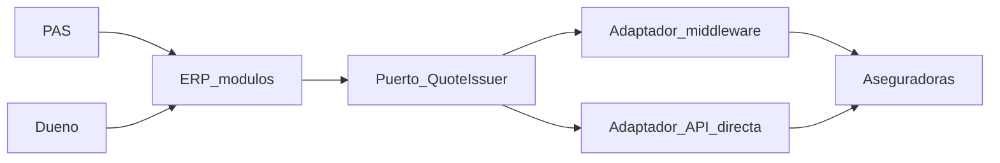

# Asesoramiento de diseño — ERP de intermediación HOM Seguros

Audiencia: dirección técnica y producto.  
Premisa: **diseño de solución**, no de stack. No se elige lenguaje, cloud ni framework.  
Rol: arquitecto senior. El sistema de registro **legal** de la póliza vive en la aseguradora. El nuestro es el **sistema de registro operativo de la red**: cliente, cotización, propuesta, productor, comisión vista por el dueño.

Decisiones ya cerradas que este documento instancia:

- Las siete verticales son la **visión**. El MVP es un recorte **usable**.
- MVP: multicotizador automotor y hogar, CRM (alta/modificación), formularios por riesgo, PDF + Compartir, dashboard del dueño.
- Cotización: **un middleware ahora**; APIs directas **después**, solo donde el hub no cubra.
- El PDF se **genera y se descarga**; el PAS lo envía con el Compartir del dispositivo. No hay WhatsApp Business API en el recorte.

---

## ARQUITECTURAS

Un “hub de integraciones” no es un producto: es una **forma de aislar dialectos ajenos** (SOAP, REST, archivos, portal) detrás de un contrato propio. En un broker, el hub existe para que el PAS cotice **una vez** y compare **varias compañías**, sin que el ERP hable el idioma de cada una.

### Qué problema resuelve el hub acá

Cada aseguradora (o el middleware que las agrupa) tiene otro modelo de riesgo, otra autenticación y otra latencia. Si el ERP se acopla a eso, cada compañía nueva **rompe** formularios, PDF y tablero. El hub tiene que ser el único lugar donde ese caos existe.

Tres hechos de dominio condicionan la arquitectura:

1. No underwriteamos. Una cotización es una **oferta ajena** que caduca; no es una póliza.
2. El PAS opera su cartera; el dueño ve la red. El hub no puede ser “otra pantalla de la compañía”.
3. El proveedor de cotización **va a cambiar** (middleware → API directa de una cía). Eso tiene que ser un recableado de borde, no una reescritura del CRM.

### Arquitecturas posibles

#### A. Punto a punto (el ERP llama N APIs)

Cada pantalla de cotización conoce Sancor, Mercantil, etc. Es lo más rápido de dibujar y lo más caro de mantener. Cada alta de compañía toca UI, PDF, validaciones y errores. **Inviable** como forma del hub, incluso si alguna API directa entra más adelante: esa API tiene que entrar como *un* conector, no como *el* modelo del sistema.

#### B. ESB / bus de integración clásico

Un bus central orquesta transformaciones, colas y reglas entre “sistemas empresa”. Encaja en un grupo con decenas de sistemas internos. Acá hay **un** producto (el ERP) y **un** borde (aseguradoras). Un ESB agrega operación, tiempos y un segundo producto que nadie pidió. Útil como *metáfora* (todo pasa por un cuello), no como pieza a comprar o construir.

#### C. Modular monolito con puertos (hexagonal) y capa anticorrupción

El ERP es un solo despliegue, partido en módulos de negocio (Cartera, Cotización, Propuesta, Organización). Hacia afuera, **puertos**: “cotizar un riesgo”, “emitir”, “bajar rúbrica”. Cada proveedor real es un **adaptador**. El modelo interno (tomador, riesgo auto, riesgo hogar, oferta comparada) **no** es el XML del middleware.

Es la arquitectura que permite el recorte MVP (un adaptador middleware) y la evolución (un adaptador por compañía) **sin** partir el producto en microservicios.

#### D. Microservicios de integración (“un servicio por compañía”)

Cada conector vive y escala aparte. Suena limpio cuando hay equipos por carrier. Con un solo equipo y un MVP de semanas, el costo es **red, contratos, observabilidad y versionado** antes de tener un PAS cotizando. Tiene sentido **más tarde** si un adaptador (p. ej. RPA de rúbrica) es tan distinto en ciclo de vida y falla que no puede compartir el proceso del cotizador.

#### E. Hub orientado a eventos

Cotización, emisión y rúbrica viajan como hechos (`QuoteRequested`, `QuoteReceived`). El PAS no espera el evento: espera **una comparativa en la pantalla**. Los eventos sirven para *después* (auditoría, tablero, alertas de vencimiento, cross-sell). Como espina dorsal del cotizador en v1, añaden consistencia eventual donde el usuario necesita **respuesta ahora**, aunque sea parcial.

### Comparación

| Forma | Encaje broker | Costo de una cía nueva | Encaje MVP |
| --- | --- | --- | --- |
| Punto a punto | Nulo | Máximo | Falso ahorra, explota en el mes 3 |
| ESB | Sobrepeso | Medio | No |
| Modular + puertos + ACL | Alto | Bajo (un adaptador) | Sí |
| Microservicios de conector | Alto a escala | Bajo por equipo | Prematuro |
| Event-first | Alto para analítica | Medio | Complemento, no núcleo del quote |

### Recomendación

**Modular monolito + puertos + capa anticorrupción.** Un único `QuoteIssuer` (puerto de aplicación) con **un adaptador middleware** en el MVP. Las APIs directas son **adaptadores nuevos** detrás del mismo puerto, no un segundo cotizador.

El dashboard del dueño, el CRM y el PDF **no** conocen el middleware. Conocen oferta canónica: compañía, ramo, premio, coberturas, vigencia de la cotización, id de correlación.

No se recomienda microservicios ni ESB hasta que un bounded context tenga un ciclo de vida distinto (el candidato natural es **rúbrica SSN / RPA**, post-MVP: trabajo largo, frágil, desacoplado del click de cotizar).

Evolución prevista: el puerto admite *fan-out* a varios adaptadores a la vez (middleware + una directa). La comparativa unificada es una **agregación de ofertas**, no una unión de pantallas.

---

## PATRONES DE DISENO

Los patrones no se eligen “porque son de libro”. Se eligen porque el hub **traduce**, **espera a varios** y **no puede contaminar** el CRM con el schema de una compañía.

### Capa anticorrupción (ACL)

Concepto: una frontera que traduce el modelo de un sistema ajeno al nuestro, para que el ajeno no dicte entidades internas.

En el hub: el DTO del middleware (códigos de producto, primas desglosadas, errores SOAP) **muere** en el adaptador. Adentro viven `Riesgo`, `Oferta`, `Cobertura`, `Tomador`. Sin ACL, “hogar” y “auto” se infectan con campos de la primera API que integraron.

**Recomendación:** obligatorio en el borde de cotización, y más adelante en rúbrica y (si existiera) emisión. No es opcional.

### Puertos y adaptadores

Concepto: la aplicación define *qué* necesita (`cotizar(riesgo) → ofertas[]`). La infraestructura define *cómo*.

Permite el recableado middleware → directa sin tocar formularios ni PDF. El test de producto es: “¿puedo mentir un adaptador en memoria y seguir generando una propuesta?”. Si la respuesta es no, el puerto está mal dibujado.

**Recomendación:** un puerto de cotización; más adelante puertos distintos para emisión, inbound de cartera y rúbrica. No un “superpuerto Integraciones” que mezcle cotizar con bajar Excel de SSN.

### Fachada de comparativa

Concepto: una interfaz simple delante de un subsistema complejo.

El PAS ve una grilla: compañía, premio, coberturas, validez. Detrás hay fan-out, timeouts y ofertas incompletas. La fachada **normaliza** y **ordena**; no es un pasamanos del JSON del vendor.

**Recomendación:** la comparativa es un objeto de aplicación (`Comparativa`), no un array crudo de respuestas. Incluye estado por compañía: ok, timeout, rechazado, no cubre el riesgo.

### Strategy (ramo y mapeo)

Concepto: el algoritmo varía, el flujo no.

Dos usos:

1. **Formulario dinámico:** auto ≠ hogar (patente/suma/uso vs domicilio/metros/tipo de vivienda). Cada ramo es una strategy de *schema* y de *validación*, no un `if ramo` eterno en la UI.
2. **Mapeo a proveedor:** cada adaptador traduce el riesgo canónico al payload del vendor.

**Recomendación:** strategy de schema en el núcleo (producto). Strategy de mapeo **solo** en adaptadores.

### Fan-out con tiempo límite (scatter-gather)

Concepto: disparar N consultas, juntar las que llegaron a tiempo, no bloquear el resto.

Es el patrón de operación del multicotizador. Una compañía lenta **no** puede congelar al PAS (requisito de latencia). El resultado válido es una comparativa *parcial* con marcas de quién faltó.

**Recomendación:** scatter-gather en el puerto de cotización. Timeout por proveedor y timeout global de pantalla. Nunca “esperar a todas”.

### Builder / snapshot de propuesta

Concepto: construir un documento complejo paso a paso; congelar el estado.

El PDF no consulta de nuevo al middleware. Se arma sobre un **snapshot** de ofertas elegidas + tomador + riesgo + productor. Si la tarifa cambió diez minutos después, el PDF sigue diciendo lo que se cotizó. La vigencia de la oferta (p. ej. 14 días) es dato del snapshot, no un recálculo.

**Recomendación:** `Propuesta` inmutable una vez emitido el PDF. Compartir es un acto del dispositivo sobre ese archivo; el servidor no orquesta WhatsApp.

### RBAC y aislamiento de cartera

Concepto: autorización por rol y por alcance de datos.

PAS ve *su* cartera. Dueño ve red, volumen, comisiones y KPIs por productor. Las comisiones **no** viajan en el PDF del cliente ni tienen por qué estar en la pantalla de cotización del PAS.

**Recomendación:** tres roles de visión (Administrador/Dueño, Back-office cuando exista, PAS). El aislamiento es por productor en casi toda entidad de cartera, con excepción explícita de las lecturas agregadas del dueño.

### Read model (tablero)

Concepto: el camino de escritura (cotizar, alta de cliente) no es el camino de lectura gerencial.

El dashboard del dueño (ventas, comisiones, rendimiento por PAS) se alimenta de **proyecciones** sobre hechos ya ocurridos, no de joins pesados sobre la grilla de cotización en vivo.

**Recomendación:** en el MVP puede ser el mismo store con consultas de agregación. El *patrón* ya es read model: no mezclar “cotización en vuelo” con “KPI del mes”. CQRS formal (bus, dos bases) se justifica cuando el tablero y el PAS se pisen en carga; no el día uno.

### Circuit breaker y bulkhead (táctica + patrón)

Un proveedor caído no debe agotar el pool de llamadas ni tumbar el CRM. Cortar a un adaptador y seguir con los demás es parte del scatter-gather.

**Recomendación:** breaker por adaptador. El resto del ERP (alta de cliente, PDF ya generado) no depende de que el middleware esté up.

### Qué no recomendar ahora

- **Saga distribuida** para cotizar: no hay transacción de negocio de varios sistemas que deba compensarse; hay *lecturas* de precio.
- **Observer masivo / event bus** como único camino de la cotización: el PAS está síncrono-en-la-UI (aunque atrás sea async).
- **Singleton de “cliente SOAP global”** compartido entre ramos y compañías: es acoplamiento disfrazado.
- **Active Record del XML del vendor** persistido como verdad: corrompe el SoR.

### Recomendación de paquete

El hub se sostiene con **ACL + puerto QuoteIssuer + scatter-gather + strategy de ramo + snapshot de propuesta + RBAC**. Eso es el diseño. El resto (outbox, CQRS duro, microservicios) se gana con volumen o con verticales post-MVP, no se adelanta.

---

## POSIBLES TACTICAS

Táctica = decisión concreta **en este ERP**, no el nombre del patrón. Están agrupadas por vertical y por atributo de calidad.

### Hub de integración (multicotizador)

- **Un puerto, N adaptadores.** El MVP expone un adaptador middleware. Una API directa futura es otro adaptador que implementa el mismo `cotizar(riesgoCanónico)`. El PAS no elige “por Absa” o “por Sancor API”: elige compañías en la comparativa.
- **Modelo canónico de riesgo partido por ramo.** `RiesgoAutomotor` (patente, año, uso, suma, GNC, guardado) y `RiesgoHogar` (ubicación, tipo, sumas) no comparten formulario. Comparten tomador y flujo: capturar → cotizar → comparar → snapshot.
- **Fan-out con resultado parcial.** La UI muestra ofertas llegadas y “sin respuesta” por compañía. Eso es producto, no error de sistema.
- **Idempotencia y correlación.** Cada intento de cotización tiene un id. Reintentar no duplica “presupuestos fantasma” en el CRM. El PDF cita ese id.
- **Cotización ≠ emisión.** El hub de v1 **obtiene precios y coberturas**. Colocar la póliza en el portal de la compañía puede seguir fuera si el middleware no emite o si el recorte no lo incluye. No disfrazar “comparativa” de “póliza emitida”.
- **No usar el middleware como CRM.** Clientes y propuestas viven en nuestra base. El vendor es I/O.

### CRM core

- **Persona única, muchas pólizas.** El alta/modificación del MVP es el master de tomador/asegurado. Sin eso no hay cartera ramificada ni, más tarde, cross-sell.
- **Cartera ramificada como árbol de lectura.** Cliente → riesgos/pólizas → ramo. El PAS no ve un Excel plano. El dueño no entra a editar la ficha como si fuera un PAS más: entra a **medir**.
- **Alertas de vencimiento (post-MVP).** Táctica: job sobre vigencia persistida, no sobre una llamada al carrier. Requiere que la cartera tenga fechas nuestras; si la póliza “de verdad” solo está en la compañía y nunca volcó, la alerta miente. Por eso las alertas no están en el MVP.
- **Cross-sell (post-MVP).** Táctica: motor sobre *perfil + pólizas activas*, nunca sobre el XML de una cotización en vuelo. Vive en analítica, no en el adaptador.

### Generación y envío de presupuestos

- **El PDF es una proyección del snapshot**, con identidad HOM (logo, pie, vigencia de la oferta, tomador, productor, comparativa o cobertura elegida). No rehidrata precios.
- **Compartir es del cliente (OS).** El servidor entrega el archivo (y opcionalmente un link autenticado de descarga). No hay cola de WhatsApp ni plantillas de WABA en el MVP. Si más adelante se quiere disparo automático, es **otro** adaptador de canal, no un cambio del builder.
- **El PDF del cliente no lleva comisiones.** Las comisiones son táctica del dashboard del dueño.

### Dashboard del dueño

- **Métricas sobre hechos cerrados:** cotizaciones generadas, propuestas descargadas, clientes dados de alta, producción atribuida al PAS. Comisiones: lectura de lo esperado/liquidado cuando exista dato; no inventar liquidación si el carrier no informó.
- **Grain: productor.** Cada KPI se puede bajar a un PAS de la estructura. El dueño no opera la cotización del PAS; observa.
- **Separar “en vuelo” de “cerrado”.** Una comparativa a medio timeout no suma como venta.

### Formularios dinámicos

- **El schema lo manda el ramo, no la compañía.** Si Sancor pide un campo que hogar canónico no tiene, el mapeo ocurre en el adaptador (default, derivado o “no cotizable”), no ensanchando el formulario de todos.
- **Versionar schemas.** Un cambio de “hogar 2027” no reescribe pólizas ni PDFs viejos. El snapshot guarda la versión de schema usada.

### Rúbrica SSN (visión, no MVP)

- **Bounded context aparte.** Descarga desde portales, compresión y paquete para SSN es I/O frágil (RPA o robot de archivos). No comparte transacción ni pool con el cotizador.
- **Nunca en el click del PAS.** Es un proceso de organizador/back-office, calendarizado.
- **ACL propia.** Los archivos de Operaciones/Cobranzas/Rendiciones no se convierten en el modelo de `Cliente`. Se **custodian** y se **preparan**. Si un día el middleware entrega esos archivos por API, se cambia el adaptador; el paquete SSN sigue siendo el mismo caso de uso.

### Siniestros (visión, no MVP)

- **Registro interno, no portal de la compañía.** Formulario de denuncia + comentarios + adjuntos + **índice** (`idTramiteCarrier` / URL / número que el PAS copió).
- **No RPA de carga de siniestro** en el carrier (distinto de rúbrica). El trámite real sigue en el sistema de la aseguradora; nosotros no somos esa fuente.
- **Misma persona que el CRM.** El siniestro cuelga del cliente/póliza interna, no de un hilo de mails suelto.

### Capacitación (visión, no MVP)

- **Repositorio, no el hub.** Contenido formativo por productor o por red. Publicación es facultad del dueño (o de quien se defina). No viaja en el puerto de cotización.
- **Separar “aviso de compañía” de “curso”.** Si más adelante vuelven avisos de portales, son otro origen (consume/publica). Capacitación es editorial.

### Tácticas transversales (calidad)

| Atributo | Táctica en este sistema |
| --- | --- |
| Latencia percibida | Scatter-gather + spinner por compañía; el CRM permanece usable si el hub está lento |
| Seguridad | RBAC; auditoría de quién cotizó, quién descargó PDF, quién editó cliente; datos de tomador bajo 25.326 |
| Evolución de compañías | Nuevo adaptador; prueba de contrato contra el puerto, no contra la UI |
| Fallo de un vendor | Breaker; comparativa parcial; no tumbar altas de cliente |
| Usable desde el día uno | Un despliegue, un SoR, un adaptador de cotización, PDF descargable; el resto de verticales no bloquean esa operatoria |
| Identidad | Logo y propuesta son marca HOM; el middleware no aparece en el PDF del asegurado |

### Orden de ataque (sin ser cronograma de proyecto)

1. SoR de personas + RBAC + schemas auto/hogar.  
2. Puerto QuoteIssuer + adaptador middleware + comparativa + snapshot + PDF.  
3. Tablero del dueño sobre esos hechos.  
4. Post-MVP: alertas, cross-sell, siniestros-índice, capacitación, rúbrica como worker aislado, adaptadores directos puntuales.

Si una táctica posterior (RPA, WABA, API directa) **entra al módulo de cotización**, el diseño falló: hay que volver a la frontera del puerto.
