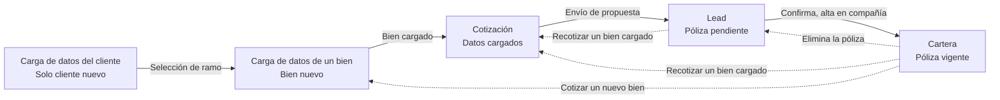

# Transición de estados por bien

El estado pertenece al bien asegurado. Un cliente puede tener un ramo en Lead y otro en Cartera al mismo tiempo. El nombre del cliente no se parte.

Ejemplo: un automotor pendiente y un hogar vigente conviven. El alta en la compañía mueve solo ese bien a Cartera. Eliminar el automotor manda ese registro a Lead y deja el hogar vigente donde está.

Línea continua: avance del bien. Línea punteada: vuelta. Cartera es el único nodo de póliza vigente.

## Dos vueltas que no se mezclan

**Recotizar un bien cargado.** Sale de Lead o de Cartera y entra directo a Cotización. El bien ya tiene datos: no se vuelve a cargar. Desde Lead es una propuesta pendiente. Desde Cartera es la póliza vigente de ese mismo bien.

**Cotizar un nuevo bien.** Sale de Cartera cuando el cliente ya está registrado y tiene al menos una póliza vigente. Entra a Carga de datos de un bien. Es otro bien, no una recotización del que ya está cargado.

**Automotor nuevo de un cliente que ya tiene vigentes.** Puede ser otro automotor, o un hogar, o cualquier ramo que ya esté en Cartera. No se crea otro cliente. El automotor nuevo recorre póliza pendiente y, cuando el cliente confirma, queda vigente en Cartera bajo el mismo nombre, junto con las pólizas que ya tenía.

**Cambio de automotor.** El automotor nuevo se asocia como póliza pendiente. Pasa a confirmada y vigente a medida que el cliente responde. El automotor anterior no se reemplaza solo: hay que eliminar esa póliza.

**Eliminar una póliza.** Siempre manda ese registro a Leads, con el detalle del bien que se tenía asegurado. No cambia si el cliente tiene otros bienes o no. Las pólizas que siguen vigentes permanecen en Cartera, bajo el mismo cliente.

**Última póliza vigente.** Al eliminarla, el cliente deja de mostrarse en Cartera. Sus datos siguen almacenados. En Leads queda el registro de esa póliza: es la última vista en la que el PAS puede verlo. En Cotizar, "Cliente existente" lo ofrece igual, esté o no en Leads (REF CU-10-Multicotizador_Seleccionar_o_Crear_Cliente).

**Conservación.** Una vez enviada una cotización, el cliente permanece en la base hasta que un administrativo decida borrarlo. Ninguna operación del PAS lo elimina: solo deja de mostrarlo en sus vistas.

## Nodos

| Nodo | Qué representa | Cómo se llega |
| --- | --- | --- |
| Carga de datos del cliente | Datos personales del cliente nuevo | Inicio. Un cliente ya registrado no pasa por acá |
| Carga de datos de un bien | Datos de un bien que todavía no estaba cargado | Selección de ramo, o cotizar un nuevo bien desde Cartera |
| Cotización | Cotización con los datos del bien ya cargados | Fin de la carga del bien, o recotizar un bien cargado |
| Lead | Póliza pendiente de ese bien, o el registro de una póliza eliminada | Envío de propuesta, o eliminar esa póliza |
| Cartera | Póliza vigente de ese bien | El cliente confirma y se da de alta en la compañía |

## Transiciones

| Desde | Transición | Hacia | Efecto |
| --- | --- | --- | --- |
| Carga de datos del cliente | Selección de ramo | Carga de datos de un bien | El cliente nuevo elige el ramo y pasa a cargar el bien |
| Carga de datos de un bien | Bien cargado | Cotización | Con el bien cargado se abre la cotización |
| Cotización | Envío de propuesta | Lead | La propuesta enviada deja el bien en Lead. Todavía no está en Cartera |
| Lead | Confirma, alta en compañía | Cartera | Confirmación del cliente y alta en la compañía. Ese bien pasa a vigente |
| Cartera | Elimina la póliza | Lead | Ese registro pasa a Leads con el detalle del bien que se tenía asegurado. Las otras vigentes siguen en Cartera. Si era la última, el cliente deja de mostrarse en Cartera, sus datos siguen guardados y sigue en "Cliente existente" |
| Lead | Recotizar un bien cargado | Cotización | Recotiza la propuesta pendiente con los datos que el bien ya tiene |
| Cartera | Recotizar un bien cargado | Cotización | Recotiza la póliza vigente de ese bien, sin cargar un bien nuevo |
| Cartera | Cotizar un nuevo bien | Carga de datos de un bien | Cliente ya registrado, con pólizas vigentes. El bien nuevo queda pendiente y, al confirmarse, se suma en Cartera bajo el mismo cliente |
