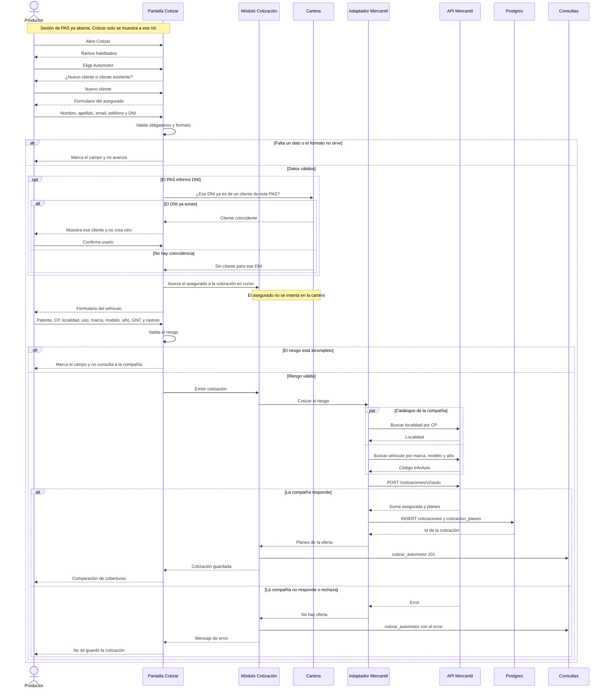

# Vista de secuencia — Efectuar cotización de un productor logueado para un nuevo asegurado

Escenario de los casos CU-09, CU-10 (cliente nuevo), CU-17 y la emisión que hoy hace el adaptador de Mercantil. El productor ya inició sesión (CU-01). Esta vista termina cuando ve las coberturas cotizadas. Armar el PDF y enviarlo es otro escenario (CU-13, CU-14).

El asegurado nuevo queda asociado a la cotización. Al enviar la propuesta se persiste con `activa=false`. Entra a Cartera (`activa=true`) en CU-16 desde Pendientes, no al cotizar. Orden: ramo → cliente → riesgo (el prototipo riesgo→cliente queda desalineado).

## Participantes

| Participante | Rol en el escenario |
| --- | --- |
| Productor | PAS con sesión abierta y rol `pas` |
| Pantalla Cotizar | Ramos, datos del asegurado, vehículo y comparación |
| Módulo Cotización | Valida el riesgo y orquesta la emisión |
| Cartera | Busca el DNI del PAS. En este escenario no inserta al asegurado |
| Adaptador Mercantil | Traduce el riesgo propio al pedido de la compañía y la respuesta a planes |
| API Mercantil | Localidades, vehículos y `POST /cotizaciones/v2/auto` |
| Postgres | `cotizaciones` y `cotizacion_planes`, en una sola transacción |
| Consultas | `CONSULTAS.log`. Si la emisión falla, también `AUDITORIA.LOG` |

## Secuencia

## Qué queda al terminar

- Hay una fila en `cotizaciones` (`ramo` automotor, `company` mercantil, `status` quoted) y una fila por plan en `cotizacion_planes`.
- El productor ve los planes para comparar. Todavía no eligió cobertura ni se generó propuesta.
- Si el DNI ya existía, se reutilizó ese cliente. Si era nuevo, sus datos viajan con la cotización y la cartera no cambió.

## Dónde está hoy en el prototipo

La pantalla de automotor (`QuoteForm` en `/cotizar/automotor`) emite la cotización al confirmar el vehículo y pasa a `/cotizar/comparar`. El paso del asegurado nuevo está en `/cotizar/asegurado`: valida nombre, apellido, email, teléfono y DNI en el navegador y sigue con esos datos en la URL. No hay tabla de asegurados ni búsqueda de DNI en la cartera. El `productor_id` que se guarda sale de la configuración de Mercantil, no de la sesión abierta.
