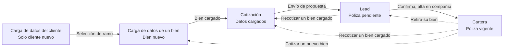

# Transición de estados por bien

El estado pertenece al bien asegurado. Un cliente puede tener un ramo en Lead y otro en Cartera al mismo tiempo.

Ejemplo: un automotor pendiente y un hogar vigente conviven. El alta en la compañía mueve solo ese bien a Cartera. Retirar el automotor lo devuelve a Lead y deja el hogar vigente donde está.

Línea continua: avance del bien. Línea punteada: vuelta. Cartera es el único nodo de póliza vigente.

## Dos vueltas que no se mezclan

**Recotizar un bien cargado.** Sale de Lead o de Cartera y entra directo a Cotización. El bien ya tiene datos: no se vuelve a cargar. Desde Lead es una propuesta pendiente. Desde Cartera es la póliza vigente de ese mismo bien.

**Cotizar un nuevo bien.** Sale de Cartera cuando el cliente ya está registrado y tiene al menos una póliza vigente. Entra a Carga de datos de un bien. Es otro bien, no una recotización del que ya está cargado.

## Nodos

| Nodo | Qué representa | Cómo se llega |
| --- | --- | --- |
| Carga de datos del cliente | Datos personales del cliente nuevo | Inicio. Un cliente ya registrado no pasa por acá |
| Carga de datos de un bien | Datos de un bien que todavía no estaba cargado | Selección de ramo, o cotizar un nuevo bien desde Cartera |
| Cotización | Cotización con los datos del bien ya cargados | Fin de la carga del bien, o recotizar un bien cargado |
| Lead | Póliza pendiente de ese bien | Envío de propuesta, o el cliente retira ese bien |
| Cartera | Póliza vigente de ese bien | El cliente confirma y se da de alta en la compañía |

## Transiciones

| Desde | Transición | Hacia | Efecto |
| --- | --- | --- | --- |
| Carga de datos del cliente | Selección de ramo | Carga de datos de un bien | El cliente nuevo elige el ramo y pasa a cargar el bien |
| Carga de datos de un bien | Bien cargado | Cotización | Con el bien cargado se abre la cotización |
| Cotización | Envío de propuesta | Lead | La propuesta enviada deja el bien en Lead. Todavía no está en Cartera |
| Lead | Confirma, alta en compañía | Cartera | Confirmación del cliente y alta en la compañía. Ese bien pasa a vigente |
| Cartera | Retira su bien | Lead | Solo ese bien vuelve a Lead. Las otras pólizas vigentes siguen en Cartera |
| Lead | Recotizar un bien cargado | Cotización | Recotiza la propuesta pendiente con los datos que el bien ya tiene |
| Cartera | Recotizar un bien cargado | Cotización | Recotiza la póliza vigente de ese bien, sin cargar un bien nuevo |
| Cartera | Cotizar un nuevo bien | Carga de datos de un bien | Cliente ya registrado, con pólizas vigentes. Se carga otro bien |
